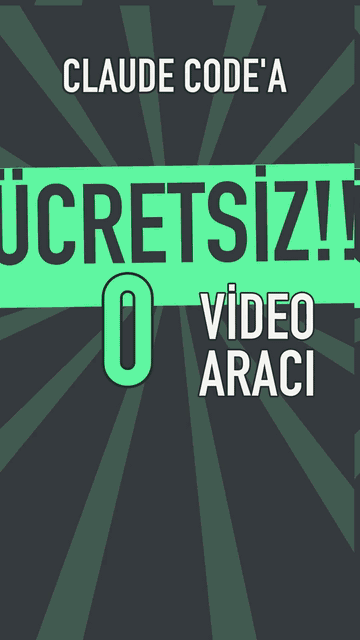
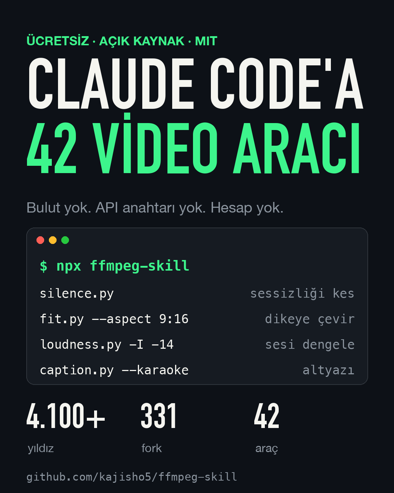

# Videoyu hâlâ elle mi kesiyorsunuz? Claude Code artık 42 araçla bunu sizin yerinize yapıyor.

4.100+ yıldız. 331 fork. Tek komut.

ffmpeg-skill.

Claude Code'a 42 video düzenleme aracı ekliyor. Bulut yok, API anahtarı yok, hesap yok. Her şey kendi bilgisayarımızda, FFmpeg ile çalışıyor.

Kurulum tek satır:
npx ffmpeg-skill

Sonra Claude'a ne istediğimizi söylüyoruz:
→ Sessiz yerleri kes
→ Yatay videoyu 9:16'ya çevir
→ Sesi -14 LUFS'a getir
→ Karaoke altyazı ekle

En sevdiğim kısmı: Claude işi bitirip "tamam" deyip geçmiyor. Önce dosyayı ölçüyor, çıktıyı kontrol ediyor, görüntü değiştiyse kareleri yan yana dizip bakıyor.

MIT lisanslı, ücretsiz.

**✨ Öne çıkanlar:**
• sessiz yerleri kesiyor
• yatay videoyu 9:16'ya çeviriyor
• sesi -14 LUFS'a getiriyor

[▶ Tam kalite video: video.mp4](video.mp4)

## Videoda adım adım

1. ffmpeg-skill. Claude Code'a kırk iki video aracı ekliyor. Bulut yok, API anahtarı yok, ücretsiz.
2. Kurulum tek satır. Sonra Claude'a ne istediğimizi söylüyoruz.
3. Sessizliği kesiyor. Dikeye çeviriyor. Sesi dengeliyor. Altyazı ekliyor.
4. En sevdiğim kısmı: işi bitirip geçmiyor, çıktıyı ölçüp kontrol ediyor.

## Kaynak

- https://github.com/kajisho5/ffmpeg-skill

## Lisans

Bu depodaki video, kart ve metinler MIT lisanslıdır (LICENSE). Anlatılan aracın kendi lisansı kendi deposundadır.
